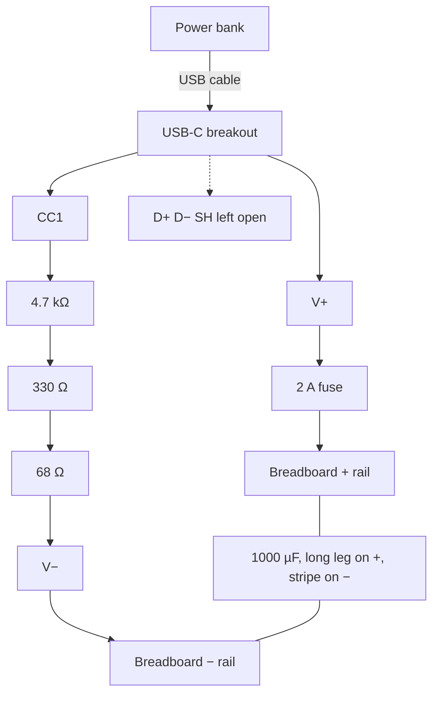
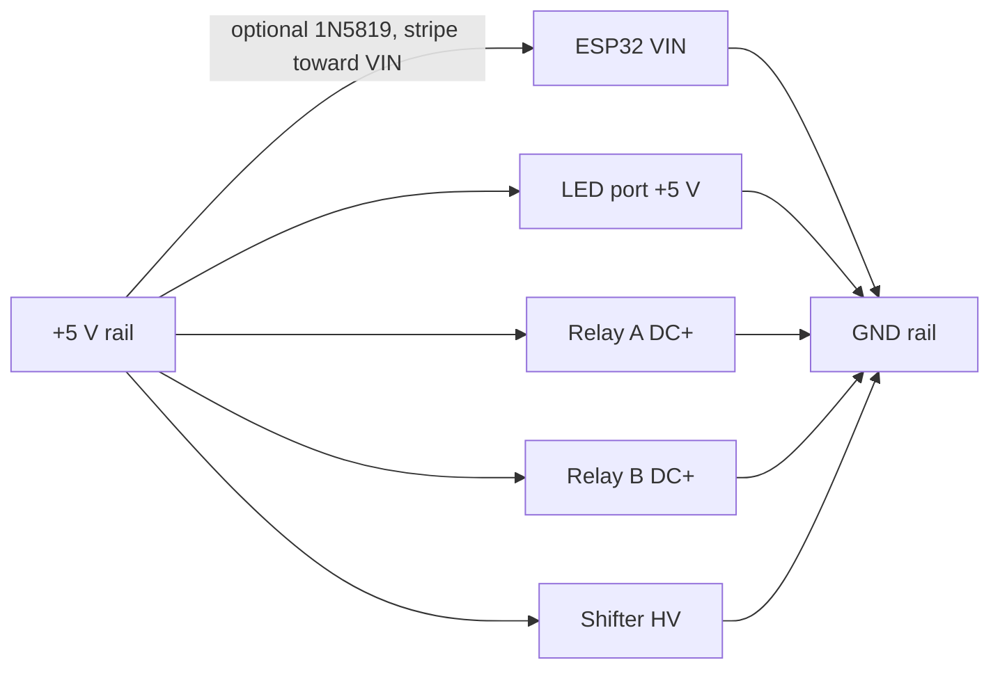
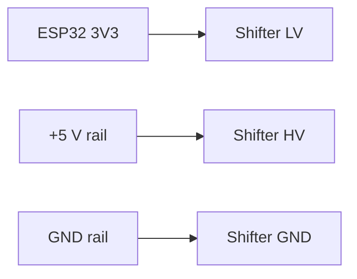
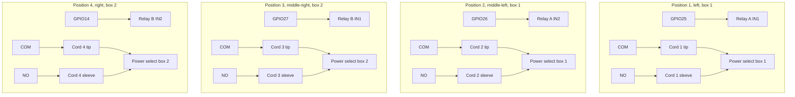
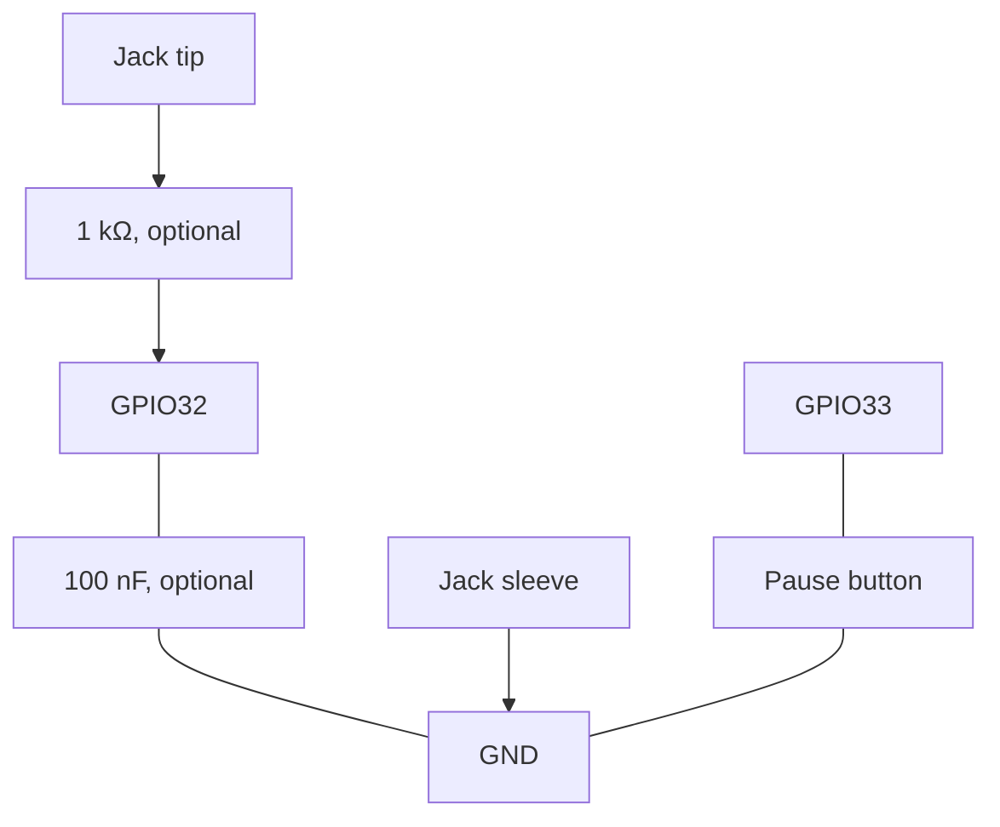

# Switch2GO AAC Companion

ESP32 single-switch light scanner for a trifold choice board. It lights up to four choices in sequence, takes a long press as a selection, types `1`–`4` plus Enter to the iPad as a Bluetooth keyboard, and can close a dry-contact relay so a power select box sees a switch press.

This device is **not** the four-switch `Switch2GO-XXXX` dongle. It advertises as **AAC Scanner**. The iPad app lives in a separate repo.

Nothing in this project has been run on hardware. Behavior and flash commands in this file follow [firmware/src/main.cpp](file:///home/grahamthetvi/Projects/Switch2GO_AAC_Companion/firmware/src/main.cpp) and [firmware/platformio.ini](file:///home/grahamthetvi/Projects/Switch2GO_AAC_Companion/firmware/platformio.ini). Work through [Build stages](#build-stages) on the bench before using it with a student.

A trifold has four physical positions: 1 on the left panel, 2 and 3 on the middle panel, 4 on the right panel. Each position has three LEDs inside a printed hood. The student sees a patch of light on the choice. One ordinary 3.5 mm switch selects. A pause button on the case stops the scan. Settings come from the iPad app over Bluetooth and are stored on the ESP32.

## How to flash

Requires [PlatformIO](https://platformio.org/) (`pio` on the PATH). From this repo:

```
cd firmware  
pio run -e scanner            \# compile  
pio run -e scanner -t upload  \# flash  
pio device monitor            \# 115200 baud
```

Bench sketches are the files in `firmware/src/stages/`. Upload the matching env. Do not paste those files into a new sketch.

| Env | Source | What it tests |
| - | - | - |
| `scanner` | `firmware/src/main.cpp` | Full firmware |
| `stage3\_led` | `firmware/src/stages/stage3\_led.cpp` | 12 WS2812E LEDs on GPIO18 |
| `stage4\_switch` | `firmware/src/stages/stage4\_switch.cpp` | Student jack on GPIO32 |
| `stage5\_pause` | `firmware/src/stages/stage5\_pause.cpp` | Pause button on GPIO33 |
| `stage6\_relay` | `firmware/src/stages/stage6\_relay.cpp` | Relays on GPIO25, GPIO26, GPIO27, GPIO14 |
| `stage7\_keyboard` | `firmware/src/stages/stage7\_keyboard.cpp` | BLE HID keys only (supports BOOT button or GPIO32) |
| `stage8\_ios\_sim` | `firmware/src/stages/stage8\_ios\_sim.cpp` | Full iOS simulation: BLE keyboard + GATT config service + BOOT button switch simulation |


Example: `pio run -e stage3\_led -t upload`

`platformio.ini` pins Espressif32 to 6.x (`espressif32@^6.5.0`), NimBLE-Arduino to 1.x (`^1.4.1`), and ESP32-BLE-Keyboard to the `0.3.2-beta` tag, with `-D USE\_NIMBLE`. Stay on platform 6.x. Arduino-ESP32 3.x (Espressif32 7 and newer) can break the keyboard library, and NimBLE 2.x renamed calls that library uses.

A desktop compile on October 11, 2026 succeeded with espressif32 6.13.0 / Arduino-ESP32 2.0.17, FastLED 3.10.7, NimBLE-Arduino 1.4.3, and ESP32-BLE-Keyboard 0.3.2. That compile was not a hardware test.

If an upload stalls at `Connecting…`, hold the board’s BOOT button until the upload starts. Use a data USB cable. If no serial port appears, install the driver for the USB-serial chip printed near the board’s USB port (often CP2102 or CH340; read the chip on your board).

## Parts

Quantities are approximate. Rows marked owned are parts already on hand. Prices are omitted on purpose.

| Qty | Part | Notes |
| - | - | - |
| 1 (+1 spare) | ESP32-WROOM-32 dev board (ESP32 DevKit style) | 30-pin and 38-pin boards label pins differently. Match every wire to your board’s pinout picture before soldering. |
| 12 LEDs | WS2812E strip, 5 V, 60 LEDs/m, owned | Cut four segments of 3 LEDs. Red = +5 V, white = GND, green = data. Do not power the rest of the reel from this device. |
| 2 (of 4 owned) | 2-channel 5 V relay module with optocoupler and H/L trigger jumpers, owned | Board A is positions 1 and 2. Board B is positions 3 and 4. One side is DC+, DC−, IN1, IN2. The other side is NO, COM, NC per channel. |
| 1 | HiLetgo 4-channel I2C logic level converter, 3.3 V–5 V, bidirectional, owned | The 10-piece listing. Same BSS138-style module described below. One channel carries LED data. Speed on WS2812 data is still a bench test. |
| 1 | USB-C female breakout, pads V+, D−, D+, CC1, V−, SH | No CC resistors and no CC2 pad. See [USB-C CC resistors](#usb-c-cc-resistors). |
| 1 | 5.1 kΩ from CC1 to V−, or 4.7 kΩ + 330 Ω + 68 Ω in series | 1/4 W or 1/2 W. This 330 Ω is not the LED data resistor. |
| 1 | 5 V 3 A lithium-ion power bank, owned | Plus a short USB cable. Auto-shutoff is still a bench test. |
| 1 | Fuse, about 1.5–2 A | Resettable PTC (polyfuse) in that hold range, or an inline holder with a 2 A fuse. In the +5 V line, right after the USB-C breakout. |
| 1 | Power switch, SPST slide or rocker, rated at least 3 A DC | Optional, in the cable. The printed case has no rocker cutout. |
| 1 | 1000 µF electrolytic capacitor, 10 V or 16 V | Across the port’s +5 V and GND. The stripe is the negative leg. |
| 2–4 | 100 nF ceramic capacitors | Optional decoupling near the ESP32 and the level shifter. |
| 1 | 330–470 Ω resistor | In series with LED data, between the level shifter and the port’s DO/DIN contact. |
| 4–6 | 1 kΩ resistors | Series resistor on the switch input, and transistor bases if you build that fallback. |
| 1 | Schottky diode, 1N5817 or 1N5819 | Optional. Stops the computer’s USB from feeding the LED and relay rail while you program. |
| 1 | Panel-mount 3.5 mm mono female jack | Student switch. A stereo jack works if you leave the ring lug unconnected. |
| 4 | 3.5 mm mono male cords | Option A or Option B under [Output cords](#output-cords). |
| 0 or 4 | Extra panel-mount 3.5 mm mono female jacks | Only for output Option B. |
| 1 | Panel-mount momentary push button, normally open | Pause. Pick a size you can print a hole for. |
| 1 | Perfboard, or an ESP32 screw-terminal breakout | Final wiring. A solderless breadboard is for the bench stages. |
| ~8–12 | 2- or 3-position screw terminals (5.08 mm or 3.5 mm pitch) | Power and relay connections you may want to undo. |
| 1 | Female 3-prong connector, plus its mating plug | Student-wall **port** for the LED strip. Contact order: +5 V, DO/DIN, GND. |
| 5 pairs | 3-pin connectors (JST-SM or JST-XH) | LED groups unplug at the trifold folds. Same contact order: +5 V, DO/DIN, GND. |
| ~3 m each | 22 AWG stranded, red and black | +5 V and GND. Silicone insulation is easier to route. |
| ~5 m | 24–26 AWG stranded, several colors | Data, switch, button, relay inputs. |
| 1 pack | Dupont jumpers (M-M, M-F, F-F) and a solderless breadboard | Bench tests, before soldering. |
| 1 kit | Heat-shrink assortment | Cover every solder joint. |
| — | Zip ties, adhesive cable clips, labels | Label cords 1–4 and relay boards A and B. |
| — | M2.5 or M3 screws, standoffs or heat-set inserts | Measure the mounting holes on your boards. |
| 4, optional | NPN transistors (2N2222, PN2222, or 2N3904) | Only if 3.3 V will not click the relays. |
| 1, optional | 74AHCT125 or SN74HCT245 | Fallback LED-data level shifter. |
| 1 + 1, optional | Logic-level N-MOSFET and a 47 Ω 1 W resistor | Only if the power bank shuts off at idle. |
| — | Filament | Matte black PLA for hoods (hold a print up to a bright light and confirm it is opaque). PLA or PETG for the case. |


## Tools

| Tool | Why |
| - | - |
| Multimeter with a continuity beep | Voltages, tip versus sleeve, and shorts before power-up. |
| Temperature-controlled iron, 0.6–0.8 mm rosin-core solder, flux | Strip pads and jacks. |
| Wire strippers (20–30 AWG) and flush cutters | Clean strips make sound joints. |
| Helping hands or a small vise | Holds parts while you solder. |
| Heat gun, or a lighter used carefully | Shrinks tubing. |
| Inline USB power meter | Current draw, including the power-bank shutoff test. |
| Small screwdrivers, tweezers, hot glue | Assembly and strain relief. |
| Safety glasses, and ventilation or a fume fan | Solder fumes and clipped leads. |
| USB data cable for the ESP32 | Charge-only cables will not upload. |


## Before you apply power

This is a 5 V project. The power bank is the only supply. The relays switch only the low-voltage switch lines of the power select boxes. They never switch mains, and no part of this device connects to a wall outlet.

Unplug power before you change a wire. Build each stage on a breadboard, then solder it once that stage passes.

Color code: red is +5 V, black (or the strip’s white wire) is GND, one color is 3.3 V, and each signal gets its own color. Label both ends.

ESP32 pins swing between 0 V and 3.3 V. Do not put 5 V onto an ESP32 pin. Power the board through VIN / 5V. The 3V3 pin is an output that feeds the level shifter.

Every GND joins one common ground: USB GND, ESP32 GND, LED white wire, both relay modules’ DC−, and the level shifter GND. Signals are meaningless until those grounds are tied.

Dry-contact terminals (relay COM and NO, and both lugs of the student jack) connect only to each other through the switch or the relay. They never touch +5 V or GND.

Before the first power-up of any new wiring, set the meter to continuity and touch +5 V and GND. A steady beep is a short. Fix it before you plug in the bank. A short chirp after the 1000 µF capacitor is fitted is the capacitor charging.

Power the 5 V rail with the ESP32 unplugged from that rail, measure about 4.8–5.2 V and confirm the red lead on +5 V reads positive, then connect the ESP32.

Solder by heating the pad and the wire together for a second or two, then feeding solder into the joint. Slide heat-shrink onto the wire before you solder. Jacks and cords need a panel nut, a knot inside the case, or a printed clamp. The solder joint is not the strain relief.

Words used below:

| Term | Meaning |
| - | - |
| GPIO | A numbered ESP32 pin the firmware reads or drives. |
| Rail | The shared +5 V wire, or the shared GND wire. |
| Pull-up | The ESP32’s internal resistor holds a pin HIGH until a switch connects it to GND. Pressed reads LOW. |
| Relay | An electrically controlled switch. The coil pulls a contact closed. |
| Dry contact | COM and NO carry no voltage of their own. Closing them is the same as pressing a switch. |
| COM / NO / NC | Common, Normally Open (connects to COM when the relay is on), Normally Closed (connects to COM when the relay is off). This build uses COM and NO. NC is unused. |
| Level shifter | Turns the ESP32’s 3.3 V data into a 5 V data signal for the LEDs. |
| Strapping pin | An ESP32 pin whose level at power-up changes how the chip boots. The pin table lists the ones to leave alone. |


## Pins

Board labels differ (`25`, `D25`, `G25`). Check your pinout diagram before soldering. PlatformIO board is `esp32dev`.

| ESP32 pin | Connects to | Mode | Notes |
| - | - | - | - |
| GPIO18 | Level shifter LV1. HV1 goes through 330–470 Ω to LED DIN | Output | FastLED data. |
| GPIO25 | Relay A IN1, position 1, cord 1, power select box \#1 | Output |  |
| GPIO26 | Relay A IN2, position 2, cord 2, power select box \#1 | Output |  |
| GPIO27 | Relay B IN1, position 3, cord 3, power select box \#2 | Output |  |
| GPIO14 | Relay B IN2, position 4, cord 4, power select box \#2 | Output | May pulse during boot and click relay 4. Untested. If it clicks, move this wire to GPIO13, set `PIN\_RELAY\[3\]` from 14 to 13 in `firmware/src/main.cpp`, and change the pin list in `firmware/src/stages/stage6\_relay.cpp`. |
| GPIO32 | Switch jack tip, through an optional 1 kΩ | INPUT\_PULLUP | Sleeve to GND. Pressed = LOW. |
| GPIO33 | Pause button, other leg to GND | INPUT\_PULLUP | Pressed = LOW. |
| GPIO4 | Optional keep-alive MOSFET gate, through about 100 Ω | Output | Leave disconnected unless you build that circuit. Firmware leaves it off. |
| 3V3 | Level shifter LV | Power out | Do not feed 5 V into this pin. |
| VIN / 5V | +5 V rail, optionally through the 1N5819 | Power in | Stripe of the diode toward VIN. |
| GND | GND rail | — | Use more than one GND pin if that is easier. |


Leave these pins unwired:

- GPIO0, GPIO2, GPIO5, GPIO12, and GPIO15 are strapping pins. GPIO12 held HIGH at boot can select the wrong flash voltage and the board will not start. GPIO0 is the BOOT button.

- GPIO1 and GPIO3 are USB serial TX and RX.

- GPIO6–GPIO11 are tied to the onboard flash.

- GPIO34, GPIO35, GPIO36 (VP), and GPIO39 (VN) are input-only and have no internal pull-up.

- EN is reset. It reboots the chip and drops Bluetooth. It is not the pause button.

```
flowchart LR  
  PB\["Power bank 5V 3A"\] --\>|USB cable| USBC\["USB-C breakout plus 5.1k CC resistors"\]  
  USBC --\> FUSE\["Fuse about 1.5-2A"\] --\> PSW\["Power switch optional"\] --\> RAIL\["+5V rail and 1000uF cap"\]  
  RAIL --\> ESP\["ESP32 VIN"\]  
  RAIL --\> PORT\["Port +5V, DO/DIN, GND"\]  
  PORT --\> LEDS\["12x WS2812E"\]  
  RAIL --\> RA\["Relay A"\]  
  RAIL --\> RB\["Relay B"\]  
  RAIL --\> LS\["Level shifter HV"\]  
  ESP --\>|3V3 and GPIO18| LS  
  LS --\>|"330-470 ohm"| PORT  
  ESP --\>|GPIO25 GPIO26| RA  
  ESP --\>|GPIO27 GPIO14| RB  
  SWJ\["Switch jack tip"\] --\>|GPIO32| ESP  
  BTN\["Pause button"\] --\>|GPIO33| ESP  
  RA --\>|COM and NO| C12\["Cords 1 and 2"\] --\> PSB1\["Power select box 1"\]  
  RB --\>|COM and NO| C34\["Cords 3 and 4"\] --\> PSB2\["Power select box 2"\]  
  ESP -.-\>|BLE keyboard and config| IPAD\["iPad"\]
```

## Power

Twelve WS2812-type LEDs at full white can draw on the order of 0.7 A (about 60 mA each; check the WS2812E datasheet for your strip). A full 5 m reel is hundreds of LEDs and is far past a 3 A bank. Cut off the 12 LEDs this device uses and do not power the rest of the reel from it.

In normal scanning only one position is lit (three LEDs). The firmware caps brightness with `LED\_GLOBAL\_MAX\_BRIGHTNESS = 100` (about 40% of 255) and FastLED’s limiter at 500 mA. Tune brightness on site. A dim room often looks right at a lower setting.

### USB-C CC resistors

This USB-C breakout does not include CC resistors. Its pads are labeled V+, D−, D+, CC1, V−, and SH. There is no CC2 pad. Solder 4.7 kΩ, then 330 Ω, then 68 Ω, in series from CC1 to V−. That string is about 5.1 kΩ. One 5.1 kΩ resistor from CC1 to V− is the same connection. Leave D+, D−, and SH open. A breakout that also has a CC2 pad needs a second 5.1 kΩ from CC2 to GND. Without the pull-down, a USB-C-to-C cable usually leaves V+ at 0 V. Add the resistor before the Stage 1 voltage check. A USB-A-to-C cable can still power the breakout if you are only proving the rest of the rail, because a USB-A source does not need the CC resistor.

### Power wiring



If you add the power switch, it goes in the red wire between the fuse and the + rail. The 330 Ω above is part of the CC1 string. The LED data resistor is a different 330–470 Ω part, shown under [Wiring](#wiring).



Each module connects across the two rails. The ESP32’s other shifter supply, LV, comes from the 3V3 pin, not from the + rail. That wire is in the data drawings below.

The fuse sits immediately after the breakout so a short in the case cannot heat the wiring. The 1000 µF capacitor sits at the port, across that connector’s +5 V and GND contacts. Long leg / + goes to +5 V. The striped leg goes to GND. An electrolytic connected backwards can fail violently.

Estimates to check with a USB power meter:

| Load | Typical while scanning | Worst case |
| - | - | - |
| ESP32 + BLE | about 0.10–0.15 A | about 0.25 A in radio peaks |
| 3 LEDs at the brightness cap | about 0.05–0.08 A | depends on color |
| 12 LEDs, full white, cap removed | — | about 0.72 A (the firmware cap is there to prevent this) |
| 12 LEDs “off” | about 0.01 A | about 0.5–1 mA each; check your strip |
| One relay coil | 0 A most of the time | about 0.07–0.09 A (read the part number on the relay) |
| Level shifter and relay-board LEDs | about 0.01 A | about 0.03 A |


A normal scan is roughly 0.2–0.3 A. Stacking the uncapped 12-LED figure, every relay coil, and the ESP32 peaks is about 1.3–1.4 A. The firmware closes only one relay, and the brightness cap limits LED current to 500 mA, so a real scan stays under the 1.5–2 A fuse and the 3 A bank.

### Programming and the power bank

The ESP32’s USB port and the power bank both meet at the 5 V pin if the bank is on while you upload. Some boards already have a diode on that path and some do not. Check your board.

The safe habit is to switch the power bank off before you plug the ESP32 into the computer. Fit the 1N5819 between the +5 V rail and VIN, stripe toward VIN, if you want the computer connected while the bank may still be on. The ESP32 then sees about 4.6–4.8 V, which its regulator accepts. Confirm by measuring the 3V3 pin (about 3.3 V). With the bank off and that diode fitted, the LEDs and relays have no power. Turn the bank on for LED and relay tests.

### Power bank auto-shutoff

Many banks turn off when the load stays under a threshold that is often somewhere around 50–150 mA. This scanner’s idle draw is about 0.15–0.25 A. That may be enough to keep your bank on. It may not. This has not been tried.

Test: run a normal scan for 30–60 minutes through a USB power meter and watch for a cutoff. If the bank shuts off, use an always-on or low-current mode if the bank has one, or use a bank made for small loads.

Optional keep-alive, only after that test fails. A logic-level N-MOSFET switches a 47 Ω 1 W resistor across 5 V (about 100 mA, about 0.5 W while on) for 0.5 s every 15 s. GPIO4 drives the gate. The resistor gets warm; give it air. `KEEPALIVE\_ENABLED` in `firmware/src/main.cpp` is `false` until you build this circuit. Shorten the pulse until the bank just stays awake. Do not raise LED brightness to keep the bank on. That changes what the student sees.

```
+5 V rail --\[47 Ω 1 W\]-- drain  
GPIO4 --\[100 Ω\]-- gate     logic-level N-MOSFET  
gate --\[100 kΩ\]-- GND      (holds the MOSFET off at boot)  
source -------------------- GND
```

## Wiring

```
GPIO18 --\> shifter LV1 -\> HV1 --\> 330–470 Ω --\> port (+5 V, DO/DIN, GND) --\> LED group 1 -\> 2 -\> 3 -\> 4  
GPIO25 --\> Relay A IN1  == COM/NO ==\> cord 1 --\> power select box \#1  
GPIO26 --\> Relay A IN2  == COM/NO ==\> cord 2 --\> power select box \#1  
GPIO27 --\> Relay B IN1  == COM/NO ==\> cord 3 --\> power select box \#2  
GPIO14 --\> Relay B IN2  == COM/NO ==\> cord 4 --\> power select box \#2  
GPIO32 \<-- student switch jack tip    (sleeve to GND)  
GPIO33 \<-- pause button               (other leg to GND)
```

### Data connections

LED data leaves GPIO18, rises to 5 V in the shifter, and then walks from each group’s DOUT to the next group’s DIN. The 330–470 Ω resistor is the only part in that data wire. Plus and ground travel beside it on the port and on every fold connector, in the order +5 V, DO/DIN, GND.




Relay inputs are the GPIO wires. COM and NO are a separate contact on the same module. They go only to that cord’s tip and sleeve, then to the power select box. They do not join a GPIO, the + rail, or GND.



The student switch and the pause button close their pin to ground. The ESP32’s internal pull-up holds the pin high until that happens.



A power select box jack expects a switch: tip and sleeve shorted together, with the box supplying its own small sense voltage. An ESP32 pin is a voltage referenced to the ESP32’s ground, so it is the wrong kind of signal to put on that jack. The relay contact is an isolated switch. Each cord lands only on one channel’s COM and NO.

### Level shifter

WS2812-family LEDs on 5 V usually want a data high around 0.7 × 5 V. The ESP32’s 3.3 V high is a bit under that. It often works on a short wire and is still outside the usual datasheet figure. The shifter sits in between.

The owned part is the HiLetgo 4-channel I2C bidirectional module (BSS138 and pull-ups, the same style of board as the common 4-channel I2C shifters). Hookup:

- LV to the ESP32 3V3 pin

- HV to the +5 V rail

- GND (either or both GND pins) to common ground

- LV1 from ESP32 GPIO18

- HV1 through 330–470 Ω to the port’s DO/DIN contact, which goes to the green DIN of the first LED group

```
ESP32 3V3  ------------------\> LV  
ESP32 GND  ------------------\> GND          HiLetgo shifter  
+5 V rail  ------------------\> HV  
GND rail   ------------------\> GND  
ESP32 GPIO18 ----------------\> LV1  
                                 HV1 --\[330–470 Ω\]--\> port DO/DIN --\> group 1 DIN  
  
+5 V rail --+-- port +5 V  --\> group 1 +5 V  
            |  (+)  
         \[1000 µF\]  
            |  (stripe −)  
GND rail  --+-- port GND   --\> group 1 GND
```

These modules were made for slow buses such as I2C. WS2812 data is 800 kHz, with pulses around 0.4 µs, and the rising edge depends on pull-up resistors. Flicker, wrong colors, or later groups misbehaving are the signs it is too slow. That speed check is Stage 3 and is still open. Fallbacks are at the end of this section. The 330–470 Ω resistor stays between the shifter and the port’s DO/DIN contact either way.

A 74HC595 shift register does not convert voltage levels. This build does not use one.

### LED chain

The strip has arrows. Data flows in the arrow’s direction. Always feed the DIN end (the arrow points away from the pads you solder). Cut only on the marked copper pads. Keep each group of three as one uncut piece. At 60 LEDs/m the pitch is about 16.7 mm, so a group is about 50 mm long. Measure yours.

Firmware index order, first LED in the chain is index 0:

| Position | Panel | LED indexes |
| - | - | - |
| 1 | Left | 0–2 |
| 2 | Middle-left | 3–5 |
| 3 | Middle-right | 6–8 |
| 4 | Right | 9–11 |


```
LEFT                    MIDDLE                         RIGHT  
\[hood 1 / pos 1\]        \[hood 2 / pos 2\] \[hood 3\]      \[hood 4 / pos 4\]  
LEDs 0-2                LEDs 3-5         LEDs 6-8      LEDs 9-11  
  
Case port -\> G1 DIN .. G1 DOUT -\> G2 DIN .. G2 DOUT -\> G3 DIN .. G3 DOUT -\> G4 DIN  
Each link is three wires: +5 V (22 AWG), GND (22 AWG), DATA (24–26 AWG).  
Put a 3-pin connector at each trifold fold.
```

The student-wall opening labeled **port** is that first plug: a female 3-prong connector. Contact order is +5 V, DO/DIN, GND. DO is the level-shifter output after the 330–470 Ω resistor, and it lands on group 1 DIN. Use the same order on every fold connector. Power off before mating the port. The 1000 µF capacitor sits at this plug, striped leg to GND.

Runs up to about a meter between groups are usually fine, because each LED regenerates the data. Confirm that with your panel spacing. If the far groups look yellow or red instead of white, also run +5 V and GND straight to group 4. At these currents that is unlikely.

### Relay modules

Set both jumpers on both boards to H (high-level trigger). In H mode the relay turns on when IN is HIGH and off when IN is LOW. `RELAY\_ACTIVE\_HIGH` in the firmware is `true` for that.

H mode is the one to use with a 3.3 V GPIO. In L mode the optocoupler LED is typically powered from the board’s 5 V, and a 3.3 V “high” can leave the relay partly on. H mode’s off state is 0 V. During ESP32 boot the pins sit low or float, so H mode stays off. Still watch the first second: GPIO14 is a separate boot question, listed under [Still to confirm on the bench](#still-to-confirm-on-the-bench).

Whether 3.3 V reliably clicks these boards in H mode is still a bench test (Stage 6). Do that test before you trust a channel.

```
+5 V rail ----\> DC+ (VCC)  
GND rail  ----\> DC− (GND)     Jumper CH1: H    Jumper CH2: H  
GPIO25    ----\> IN1           (board B uses GPIO27 and GPIO14, cords 3 and 4)  
GPIO26    ----\> IN2  
  
CH1  COM o---- cord 1 TIP  
     NO  o---- cord 1 SLEEVE  
     NC     unused  
CH2  COM o---- cord 2 TIP  
     NO  o---- cord 2 SLEEVE  
     NC     unused
```

COM and NO never touch +5 V, GND, or the ESP32. Polarity of COM versus NO does not change a dry contact. Wiring tip to COM and sleeve to NO on every cord makes faults easier to find.

If your board has a JD-VCC jumper instead of H/L jumpers, it is a different module. See [Fallback circuits](#fallback-circuits). Read the silkscreen. The owned boards are the H/L style.

### Student switch

Assistive switches use a 3.5 mm mono plug. Pressing connects tip to sleeve. Power select boxes accept that same closure on their switch ports.

Panel jack tip lug, through an optional 1 kΩ, goes to GPIO32. Sleeve lug goes to GND. An optional 100 nF from GPIO32 to GND, after the 1 kΩ, softens static from a cable a student handles. The pin reads HIGH when released or unplugged, and LOW when pressed.

Plugging or unplugging a plug can briefly short tip to sleeve and look like a press. Pause first, then plug or unplug the switch.

Jacks differ. Plug in a mono cable and use continuity to see which lug beeps to the tip and which to the sleeve. Do this on your jack rather than trusting a drawing.

```
Student switch ==\> \[panel 3.5 mm jack\]  
  TIP lug    --\[1 kΩ optional\]--\> GPIO32 (INPUT\_PULLUP)  
                      |  
               \[100 nF optional\]  
                      |  
  SLEEVE lug ---------+----------\> GND
```

### Pause button

BOOT is GPIO0. Holding it low at reset puts the ESP32 in firmware-download mode, and the button sits on the module inside the case. EN resets the chip and drops Bluetooth. The pause control is a separate panel button on GPIO33 to GND, using the internal pull-up. It has no boot effect.

```
GPIO33 (INPUT\_PULLUP) ------o  normally open momentary  o------ GND
```

Hold this button while power is applied to start config-only Bluetooth (no keyboard). That path is the iOS fallback in the BLE section. A normal press, after boot, pauses and resumes.

### Output cords

| Position | Board | Channel | Cord | Goes to |
| - | - | - | - | - |
| 1 left | A | IN1 / CH1 | 1 | Power select box \#1 |
| 2 middle-left | A | IN2 / CH2 | 2 | Power select box \#1 |
| 3 middle-right | B | IN1 / CH1 | 3 | Power select box \#2 |
| 4 right | B | IN2 / CH2 | 4 | Power select box \#2 |


With two choices the firmware lights positions 2 and 3, so one cord goes to box \#1 and one to box \#2. With one choice only cord 2 is used. With three choices cords 1 and 2 go to box \#1 and cord 3 goes to box \#2. Cord 4 is unused until you run four choices. The teacher picks the port and the mode on each box.

**Option A, hard-wired cords.** Cut two mono male-to-male 3.5 mm cables in half. That yields four pigtails. Continuity-test which conductor is the tip and which is the sleeve (the shield is usually the sleeve; confirm it). Tip to COM, sleeve to NO. Knot or clamp the cable inside the case. Label 1, 2, 3, 4 with colored heat-shrink.

**Option B, jacks on the case.** Four panel mono jacks labeled 1–4, each wired COM/NO the same way, and ordinary male-to-male mono cables out to the boxes. A damaged cable is then a swap, not a resolder.

A stereo plug in a mono jack lets the ring touch the sleeve. That is harmless here. The cord wires still go only to COM and NO.

```
Relay COM o---- tip wire ----+  
                              +=== 3.5 mm mono plug ===\> power select box  
Relay NO  o---- sleeve wire -+
```

### Fallback circuits

Use these only when the matching bench stage fails. They are untested, same as the rest of this build.

**LED data, in the order to try them.**

1. **74AHCT125** (or SN74HCT245), powered from 5 V. The “T” inputs treat 3.3 V as high, and the outputs are fast 5 V. For a DIP-14 74AHCT125 the usual pins are: pin 14 = 5 V, pin 7 = GND, pin 1 (1OE) = GND, pin 2 (1A) from GPIO18, pin 3 (1Y) through 330 Ω to DIN. Tie unused inputs (pins 5, 9, 12) to GND and their OE pins (4, 10, 13) to 5 V. Confirm the pinout in the datasheet for your package.

2. **Sacrificial pixel.** One extra WS2812 next to the ESP32, powered through a 1N4001 so it runs near 4.3 V. Its input threshold drops enough to accept 3.3 V, and it resends a clean signal to the 12 real LEDs. That extra pixel has to be index 0 and stay dark, with the real LEDs at indexes 1–12. `NUM\_LEDS` is currently `NUM\_POSITIONS \* LEDS\_PER\_POS` (12), and the render loop writes those indexes directly, so this fallback needs a one-pixel offset or the hoods light the wrong groups. Bench-test it.

3. **Direct short wire.** GPIO18 through 330 Ω to DIN, no shifter, first LED within about 30 cm. Outside the LED input spec. Acceptable on a prototype if Stage 3 stays clean on the real wire lengths.

**Relay input, if the 3.3 V touch test does not click.** One NPN per channel (2N2222 or 2N3904), jumper on L:

```
GPIO --\[1 kΩ\]-- base  
emitter ----------- GND  
collector -------- relay IN
```

GPIO high pulls IN to ground, and L mode then turns the relay on, so `RELAY\_ACTIVE\_HIGH` stays `true`. At boot the GPIO is low, the transistor is off, and the relay is off. Flat-side-facing-you with legs down is often E-B-C on these parts; confirm the datasheet.

Three spare channels on the HiLetgo board can lift relay inputs to 5 V (a second module covers the fourth). The transistor is the more predictable of the two.

**JD-VCC boards.** Remove the JD-VCC jumper. JD-VCC = 5 V for the coils, VCC = ESP32 3.3 V for the optocouplers, GND = common ground. A GPIO low turns the relay on. Set `RELAY\_ACTIVE\_HIGH` to `false`. With VCC at 3.3 V, a high output fully turns the optocoupler off.

## Build stages

Stop at the first stage that fails. The pass line is the gate to the next stage. Upload the env named in the stage. The sketches already include `Arduino.h`.

### Stage 0: Software setup

Install PlatformIO. From `firmware/`:

```
pio run -e scanner  
pio run -e stage4\_switch -t upload  
pio device monitor
```

`scanner` proves the libraries compile. `stage4\_switch` is safe with nothing wired: it only reads GPIO32 with the internal pull-up. **Pass:** the upload finishes, and the monitor opens at 115200 and stays quiet. Hold BOOT if the upload sits on `Connecting…`.

### Stage 1: Power rail, ESP32 not attached yet

Wire USB-C breakout, with both 5.1 kΩ CC resistors, then the fuse, then the optional switch, then the +5 V and GND rails. Continuity from +5 V to GND must not beep steadily. Plug in the power bank. **Pass:** the rail measures about 4.8–5.2 V, red lead on +5 V, polarity positive. If a USB-C-to-C cable reads 0 V, the CC resistors are missing or on the wrong pads.

### Stage 2: ESP32 on the 5 V rail

Power off. Connect +5 V (through the 1N5819 if you fitted it) to VIN / 5V, and GND to GND. Power on. **Pass:** the board’s power LED lights, and the 3V3 pin measures about 3.3 V. Switch the bank off, plug in the computer, upload `stage4\_switch` again, and confirm the monitor still opens.

### Stage 3: LEDs

Env: `stage3\_led` (`firmware/src/stages/stage3\_led.cpp`).

Start with one group of three. Red to +5 V, white to GND, 1000 µF across them (stripe to GND), green from GPIO18 through 330–470 Ω. Try that direct wire first.

```
pio run -e stage3\_led -t upload
```

You should see red, then green, then blue, then dim white, one LED at a time. Then insert the level shifter as wired above and repeat. Then chain all four groups at the real wire lengths and repeat.

**Pass:** correct colors, in order, no flicker, no random flashes, including through the HiLetgo module. If red and green are swapped, change `GRB` to `RGB` in `stage3\_led.cpp` and in the `FastLED.addLeds` line in `firmware/src/main.cpp`. WS2812E color order and the shifter’s speed are bench checks, not settled measurements. If the shifter fails this pass, use a [fallback](#fallback-circuits) and run the stage again.

### Stage 4: Student switch

Wire tip through the optional 1 kΩ to GPIO32, sleeve to GND.

```
pio run -e stage4\_switch -t upload  
pio device monitor
```

Press briefly, then hold. **Pass:** each press prints one `DOWN` and one `UP` line. The printed duration matches how long you held it. The sketch calls a press `LONG` at 1000 ms or more, on release. Doubled lines mean you need a longer debounce or the 100 nF capacitor.

### Stage 5: Pause button

Wire the button between GPIO33 and GND.

```
pio run -e stage5\_pause -t upload  
pio device monitor
```

**Pass:** one `DOWN` and one `UP` per press, same as Stage 4. This sketch uses GPIO33.

### Stage 6: Relays

Leave student devices unplugged until the last step of this stage.

1. Jumpers on H. DC+ to +5 V, DC− to GND. Leave IN pins unconnected. Power on. No relay should click. Also tie each IN to GND in turn. Still no click.

2. With the ESP32 powered and sharing GND, touch each IN to the ESP32 3V3 pin. The relay should click on and the board LED should light. Touch that IN to GND. It should click off. Do this for all four inputs. If a channel is weak or silent, stop and build the transistor fallback before continuing.

3. Wire IN1/IN2 to GPIO25, GPIO26, GPIO27, and GPIO14.

```
pio run -e stage6\_relay -t upload  
pio device monitor
```

Each relay clicks on and off in turn (about 0.7 s each), and the monitor prints `Relay position 1` through `4`. **Pass:** that cycle, plus a continuity beep across a cord’s tip and sleeve only while that channel is on.

Watch the first second after power-up or reset. If relay 4 blips, GPIO14 is pulsing at boot. Move that channel to GPIO13 and change `PIN\_RELAY\[3\]` (and the stage sketch’s pin list) from 14 to 13. This blip has not been observed yet because the board has not been powered.

Last, plug one cord into a power select box and a battery-powered toy, or whatever the teacher actually uses, and confirm the box responds while that relay is on.

### Stage 7: Bluetooth keyboard

The switch from Stage 4 stays on GPIO32. You can also use the onboard **BOOT button (GPIO0)** on the ESP32 dev board to test without external switch wiring. (Note: the **EN button** is hardware reset and cannot be used as an input).

```
pio run -e stage7\_keyboard -t upload
```

On the iPad: Settings → Bluetooth → tap **AAC Scanner**. Open Notes, put the cursor in a note, and long-press the switch or BOOT button (≥ 1 s). **Pass:** `1` and a new line, then `2`, then `3`, then `4`, then `1` again. The onboard LED (GPIO2) blinks while advertising and stays solid when connected to iOS.

iPadOS usually hides the on-screen keyboard while a hardware keyboard is connected. That is acceptable: Switch2GO captures the hardware keys.

### Stage 8: iOS simulation & Config service

For a full standalone simulation of the ESP32 connecting to an iOS device (both BLE HID keyboard and GATT configuration/status service):

```
pio run -e stage8\_ios\_sim -t upload
```

This bench simulator runs entirely on the bare ESP32-WROOM-32 board:
- Advertises as **AAC Scanner** with both the BLE keyboard and the custom GATT service (`A5C00001-7D2B-4F6E-9C31-5B8E2A1D0C4F`).
- **BOOT button (GPIO0)** simulates the student switch:
  - **Short press** (< 1 s): enters HOLDING state (pauses scan on current choice).
  - **Long press** (≥ 1 s): fires selection, types `1`–`4` + Enter to iOS, blinks LED, and updates Status characteristic.
- Serial terminal (115200 baud) accepts commands: `'s'` (short press), `'l'` (long press), `'p'` (pause), `'c'` (print status).

You can also test the full firmware config service directly with:

```
pio run -e scanner -t upload
```

Install a BLE explorer on the iPad (nRF Connect or LightBlue). With the scanner connected as a keyboard, see whether the explorer can open the custom service `A5C00001-7D2B-4F6E-9C31-5B8E2A1D0C4F`. iOS may hide an already-paired keyboard from a scan. This path is untested. Try the app’s connected-devices list, or Forget the keyboard and scan again. Fallback: hold PAUSE while you apply power. The ESP32 then advertises only the config service and does not act as a keyboard. Reboot without holding PAUSE to return to normal.

Write the [example config](#example-config) to the Config characteristic. **Pass:** scan speed and colors change, and they survive unplugging power. Subscribe to Status and watch the bytes change as the light moves.

### Stage 9: Full bench test

Leave `scanner` loaded. All four LED groups, both relay boards, the switch, and the pause button are connected. Work through the [bench checklist](#bench-checklist). **Pass:** every line you can test without a student passes, and every open item in [Still to confirm on the bench](#still-to-confirm-on-the-bench) is either checked off or written down as still open.

### Stage 10: Make it permanent

Move the circuit to perfboard or screw terminals. Solder, heat-shrink, and label cords 1–4, boards A and B, SWITCH, PAUSE, PORT, and 5V IN. Fit the female 3-prong LED connector in the student-wall port, contacts +5 V, DO/DIN, GND. Mount the boards in the printed case. Re-run Stages 3–7 after the case is closed, because wires get bumped. Mount the hoods, route wires on the back of the trifold, and aim the hoods from the student’s seat height.

## Choice layout

Each active choice lights exactly one position and uses that position’s relay. Keys are the choice number (`1` through `N`), not the physical position. Flag bit1 in the config still switches a setup to physical-position keys. The table lives in `LAYOUT` in `firmware/src/main.cpp`.

| Choices | What lights | Cords that matter | Keys |
| - | - | - | - |
| 1 | Position 2 only (middle-left). Position 4 stays dark, and so do 1 and 3. | Cord 2 to power select box \#1 | `1` |
| 2 | Position 2, then position 3 | Cord 2 to box \#1, cord 3 to box \#2 | `1`, `2` |
| 3 | Positions 1, 2, and 3, each alone. Position 4 stays dark. | Cords 1 and 2 to box \#1, cord 3 to box \#2 | `1`, `2`, `3` |
| 4 | Positions 1, 2, 3, 4 | Cords 1 and 2 to box \#1, cords 3 and 4 to box \#2 | `1`, `2`, `3`, `4` |


Enter after the digit is on by default (flag bit0).

## How it behaves

Defaults until the app writes a config: 4 choices, 2.0 s per choice, 30 s hold, 1.0 s long press, Enter on, every position white and iPad-only (no relay). Ranges the firmware will accept: scan 0.5–60 s, hold 1–120 s, long press 0.3–5 s.

Four states: SCANNING, HOLDING, SELECTING, PAUSED.

The light steps from one active choice to the next when the scan time elapses. While the switch is held, that timer stops. The light stays on the choice that was lit when the press began.

A press becomes a selection at the moment it has been held for the long-press time. The firmware does not wait for the release. It types the choice key and, by default, Enter. If that position’s mode is iPad + relay, it closes that relay. The relay stays closed until the switch is released, for at least 200 ms, and it is forced open at 5 s even if the switch is still held. Only one relay is closed at a time, and a selection closes a relay only for a position set to iPad + relay. The relay still closes if the iPad is not connected. The keystrokes are skipped in that case.

A press released before the long-press time is a short press. It starts HOLDING: the same choice stays lit for the hold time (default 30 s). Another short press during HOLDING restarts that hold timer. While the switch is held, the hold timer waits. When the hold time runs out, scanning resumes at the next choice.

After a selection the chosen light blinks. Scanning starts again only once the switch is up, the relay is open, and at least 0.8 s have passed (`SELECT\_FEEDBACK\_MS`). **Still open:** the current firmware then restarts from the first choice (`RESTART\_FROM\_FIRST\_AFTER\_SELECT = true`). The alternative is to continue from the next choice. That choice has not been made. Change the constant in `firmware/src/main.cpp` when it is.

Pause turns the LEDs off, ignores the switch, and releases any relay. Resume starts at the first choice. Holding PAUSE while power is applied is a different path: config-only BLE, described under the BLE contract. In that mode the light stays off until you reboot.

## Settings you are most likely to change

All of these are in `firmware/src/main.cpp`.

| Constant | Default | Change it when |
| - | - | - |
| `PIN\_RELAY\[3\]` | 14 | Relay 4 clicks at boot. Set it to 13. Untested. |
| `RELAY\_ACTIVE\_HIGH` | `true` | You moved a JD-VCC board to low-trigger with no transistor. Set it to `false`. |
| `LED\_GLOBAL\_MAX\_BRIGHTNESS` | 100 | The patch of light is too dim. Raise it slowly and re-measure current. |
| `RELAY\_MIN\_MS` | 200 | The box needs a longer minimum closure. |
| `RELAY\_MAX\_MS` | 5000 | The box mode needs a longer maximum closure. |
| `SELECT\_FEEDBACK\_MS` | 800 | You want a longer or shorter blink before the scan continues. |
| `RESTART\_FROM\_FIRST\_AFTER\_SELECT` | `true` | You choose “continue from the next choice” instead. Still open. |
| `LAYOUT` | see the choice table | Only if a future layout decision changes which position a choice lights. |
| `KEEPALIVE\_ENABLED` | `false` | The keep-alive resistor and MOSFET are built, and the bank still shuts off without them. |


## BLE contract

Device name: `AAC Scanner`. The keyboard library also sends the manufacturer string `Addison Graham`.

The custom service is added on the same GATT server as the HID keyboard, after the HID services exist and before advertising starts. The custom service UUID is not in the normal advertisement. The advertisement is already full with the HID UUID, the name, and appearance. The app finds the device with `retrieveConnectedPeripherals(withServices:)` and the scanner service UUID, or by scanning for the name `AAC Scanner`.

iOS often hides an already-paired keyboard from a BLE scan, because the system owns that connection. An app can still reach the other services on that device by retrieving connected peripherals for this service UUID and then connecting with Core Bluetooth. That call is untested here. If it fails, hold PAUSE while powering on. The firmware skips the keyboard, advertises the scanner service UUID, and stays paused. Save settings, then reboot into normal mode. Settings cannot be changed live in that fallback.

iOS caches GATT layouts. If services change after pairing, forget the device under Settings → Bluetooth and pair again.

| Item | UUID | Properties |
| - | - | - |
| Scanner service | `A5C00001-7D2B-4F6E-9C31-5B8E2A1D0C4F` | — |
| Config | `A5C00002-7D2B-4F6E-9C31-5B8E2A1D0C4F` | Read, Write |
| Status | `A5C00003-7D2B-4F6E-9C31-5B8E2A1D0C4F` | Read, Notify |
| Command | `A5C00004-7D2B-4F6E-9C31-5B8E2A1D0C4F` | Write |


On a long press the device types the choice number (`1`–`N`) then Enter, unless config flag bit1 is set (physical position instead). If that position is set to iPad + relay, the relay still closes when the keyboard is not connected.

**Config** is 29 bytes, version `0x01`, little-endian. A write with the wrong length or version is ignored. Out-of-range times are clamped. An unknown mode is stored as iPad-only. A good write is saved with Preferences (namespace `aacscan`, key `cfg`) and becomes the value a later read returns. A 29-byte write is larger than BLE’s old 20-byte default. iOS usually negotiates a larger MTU. If a write does nothing, confirm the phone actually sent 29 bytes.

| Bytes | Field | Range | Default |
| - | - | - | - |
| 0 | version | `0x01` | `0x01` |
| 1 | numChoices | 1–4 | 4 |
| 2–3 | scanTenths | 5–600 (0.5–60 s) | 20 (2.0 s) |
| 4–5 | holdTenths | 10–1200 (1–120 s) | 300 (30 s) |
| 6–7 | longPressMs | 300–5000 | 1000 |
| 8 | flags | bit0 = send Enter after the digit; bit1 = key is the physical position (`1`–`4`) instead of the choice number | `0x01` |
| 9–13 | position 1 | R, G, B, brightness, mode | 255, 255, 255, 255, 0 |
| 14–18 | position 2 | same | same |
| 19–23 | position 3 | same | same |
| 24–28 | position 4 | same | same |


Mode `0` is iPad only. Mode `1` is iPad + relay. Colors and modes belong to the physical position, so they stay put when the number of choices changes. Per-position brightness is applied under the global cap. The app cannot turn the LEDs up past `LED\_GLOBAL\_MAX\_BRIGHTNESS`.

**Status** is 5 bytes. Notifications go out when any byte changes, and no more often than every 100 ms.

| Byte | Field | Meaning |
| - | - | - |
| 0 | state | `0` SCANNING, `1` HOLDING, `2` SELECTING, `3` PAUSED |
| 1 | choice | Current choice 1–N, or `0` if paused |
| 2 | position | Primary position 1–4 of that choice, or `0` if paused |
| 3 | kbConnected | `1` if the BLE keyboard link is up |
| 4 | holdSecondsLeft | Seconds left in HOLDING, otherwise `0` |


**Commands:**

| Bytes | Command |
| - | - |
| `01` | Pause |
| `02` | Resume (starts at the first choice) |
| `03` | Toggle pause |
| `10 nn` | Pulse relay position `nn` (`01`–`04`) for about 200 ms. Ignored if a relay is already closed. |
| `7F A5` | Factory-reset settings to the defaults |


### Example config

Four choices, 2.0 s scan, 30 s hold, 1000 ms long press, Enter on, choice-number keys. Position 1 red with relay, 2 green with relay, 3 blue iPad-only, 4 yellow iPad-only, all at full per-position brightness:

```
01 04 14 00 2C 01 E8 03 01  
FF 00 00 FF 01  
00 FF 00 FF 01  
00 00 FF FF 00  
FF FF 00 FF 00
```

The iPad app should read and write this layout, subscribe to Status, and capture hardware keys `1`–`4` and Enter without depending on the on-screen keyboard. A settings screen needs number of choices, scan time, hold time, long-press time, and for each position a color, a brightness, and a mode. Pause, resume, and the relay test command are the teacher controls. Show a paused state from the status bytes.

## Prints

Parametric OpenSCAD is in [cad/](file:///home/grahamthetvi/Projects/Switch2GO_AAC_Companion/cad/). Every dimension below is a starting size. Measure the strip, the jack thread, the button bushing, the board thickness, and the mounting holes, then change the named variables at the top of each file.

```
openscad -o /tmp/led\_hood.stl cad/led\_hood.scad  
openscad -o /tmp/edge\_clip.stl cad/edge\_clip.scad  
openscad -D 'part="bottom"' -o /tmp/case\_bottom.stl cad/electronics\_case.scad  
openscad -D 'part="lid"' -o /tmp/case\_lid.stl cad/electronics\_case.scad
```

**Hood** (`cad/led\_hood.scad`), one per position. A rectangular snoot matches three LEDs in a row better than a round cone. Starting inner opening about 55 × 14 mm, flaring to about 90–110 × 50–70 mm over a depth of 50–70 mm. Mount it above or beside the choice, tilted about 30–45° toward the surface, mouth about 80–150 mm from the board, opening facing away from the student. Sit at the student’s eye height. If you can see an LED, lengthen the visor or increase the tilt. Check the teacher’s angle too. Matte black PLA, three or more walls. Print the hood mouth-down. The rail in that file is a channel a bit wider than the strip, with a lip and zip-tie slots, a wire slot at the DIN end, and a data-arrow mark.

**Edge clip** (`cad/edge\_clip.scad`). A U-clip over the top of the panel, with an arm for the hood. Set `panel\_thickness` from a measurement. Foam and poster trifolds vary. Other mounts that also work: a small bolt with printed washers on both sides, or hook-and-loop on a flat printed base. Route wires on the back, through printed grommets, with the 3-pin connectors at the folds and slack so the board can close.

**Case** (`cad/electronics\_case.scad`). Adapted from the Switch2Select housing. Outside size 200 × 140 × 55 mm, wall 2.4 mm. PLA or PETG. The lid screws into corner bosses. Lay the ESP32, two relay modules, shifter, USB-C breakout, and perfboard in the box and keep the relay screw terminals reachable.

Cutouts: one scan-switch jack on the student wall (a 3.5 mm panel jack, about a 9.1 mm hole); four output cord holes, 4 mm across, labeled 1–4, each with its own pair of wrap rods; one pause/resume button hole, 13.4 mm; a 15 × 9.5 mm opening on the student wall, labeled port, for the female 3-prong LED connector (+5 V, DO/DIN, GND); USB-C power inlet on the short wall at the numeral 1 end, cutout bottom 3 mm above the interior floor. No power-rocker cutout and no hold button. Every label is raised print and Grade 1 braille: power, scan, port, pause, and 1–4. Print a small coupon to test-fit the jack, the button, and the port before the full case. Starting slicer settings: 0.2 mm layers, 3 walls, 20–25% infill.

## For the teacher

1. Plug the light strip into **port** (contacts +5 V, DO/DIN, GND), then the power bank, then the student switch. Labels on the case, in print and braille: **power**, **scan**, **port**, **pause**, cords **1–4**.

2. Pair the iPad with **AAC Scanner** in Settings → Bluetooth.

3. Cords 1 and 2 go to power select box \#1; cords 3 and 4 to box \#2. With fewer than four choices, unused cords stay unplugged. See the [choice layout](#choice-layout).

4. **PAUSE** turns the lights off and ignores the switch. Resume starts at the first choice.

5. Unplug or plug the switch only while paused.

This is a 5 V USB-bank device. Relays switch only the low-voltage switch lines of the power select boxes. They never switch mains.

## Still to confirm on the bench

These are open. Do not treat them as settled.

- **After a selection.** The firmware blinks, then restarts from the first choice. Continuing from the next choice is the other option. `RESTART\_FROM\_FIRST\_AFTER\_SELECT` selects between them. No choice has been made.

- **GPIO14 at boot.** It may click relay 4. If it does, move `PIN\_RELAY\[3\]` from 14 to 13. Not tried.

- **Power bank at idle.** About 0.15–0.25 A may or may not hold the bank on. Test for 30–60 minutes. The keep-alive circuit stays optional until that test fails.

- **Level-shifter speed.** The HiLetgo BSS138 module may be marginal at 800 kHz. Stage 3 is the test. Fallbacks stay in this file.

- **3.3 V relay trigger.** H jumpers are what the firmware expects. Whether 3.3 V clicks every channel is Stage 6. Not tried.

- **iOS and the custom service.** A paired keyboard may be invisible to a normal scan. The app should call `retrieveConnectedPeripherals(withServices:)` with the scanner service UUID. Untested. Fallback is hold PAUSE while powering on.

- **Hardware.** Nothing in this project has been powered, scanned, or paired.

## Safety

Low voltage only. Everything runs from a 5 V USB power bank. Never connect any part of this device to mains, and never use these relays to switch mains equipment. The relays switch only the switch-input lines of the power select boxes. The boxes handle their own loads, set up from the box manual.

Keep COM and NO on the output cords only. Fuse the 5 V input. A few amps at 5 V can melt thin wire.

Lithium banks: use a reputable pack, do not puncture or crush it, do not charge it inside a sealed case, and keep it out of a hot car. If it swells or gets hot, stop using it.

The electrolytic capacitor’s stripe goes to GND. Student cords stay clear of hands, mouth, and wheelchair parts. No bare solder joints. Round the case edges. Keep small parts out of reach.

Solder with ventilation, wear safety glasses, wash your hands afterward, and rest the iron in its stand. Unplug power before you rewire.

## Troubleshooting

| What you see | What to try |
| - | - |
| Nothing powers on | CC resistors missing, fuse open, or the power switch is off. Measure VBUS. A USB-A-to-C cable bypasses the CC requirement for a quick check. |
| ESP32 resets when LEDs or a relay turn on | Voltage dip. Confirm the 1000 µF capacitor, shorten and thicken the 5 V wires, lower brightness, try another USB cable. |
| Board boots alone and fails once wired | A strapping pin is being pulled. Move that wire to a pin in the pin table. |
| Upload stuck on `Connecting…` | Data cable, USB-serial driver, hold BOOT as the upload starts. |
| LEDs stay dark | Data is on DOUT instead of DIN, grounds are not common, or the wire is not on GPIO18. Follow the arrows. |
| First LED is fine, the rest flicker | Shifter is too slow, or the series resistor is missing. Try the LED fallbacks. |
| Red and green swapped | Change `GRB` to `RGB` in `addLeds`. |
| Far LEDs look yellow | Inject +5 V and GND at group 4. Use thicker power wire. |
| Relay never clicks from the ESP32 | Run the 3.3 V touch test. Jumper should be on H. If 3.3 V is not enough, add the transistor. |
| Relay stuck on or buzzing | L mode with a 3.3 V high that does not fully turn the optocoupler off. Use H mode, or the transistor, or a JD-VCC board with VCC at 3.3 V. |
| Relay 4 clicks at power-up | Move that channel to GPIO13 and set `PIN\_RELAY\[3\]` to 13. |
| Relay clicks, box does nothing | Cord is not actually tip and sleeve, or the box port/mode is wrong. Prove the box with a normal switch, then continuity-test the cord while the relay is on. |
| Double presses | Raise `DEBOUNCE\_MS`, add the 100 nF on GPIO32, keep switch wires away from relay wiring. |
| A press when the plug goes in | The jack shorts tip to sleeve as the plug seats. Pause before plugging. |
| iPad does not list AAC Scanner | Forget the device, reboot the ESP32, pair again. |
| Keys reach Notes and the app ignores them | The app is not taking hardware key events. Notes is the Stage 7 proof. The app has to handle those keys itself. |
| Config write does nothing | Serial log says `rejected write`, or iOS cached an old GATT. Send exactly 29 bytes starting with `01`. Forget and re-pair. |
| App cannot see the custom service | Use `retrieveConnectedPeripherals(withServices:)` with the scanner service UUID, or hold PAUSE at power-on. |
| `BleKeyboard` compile errors | Stay on NimBLE 1.4.x and Espressif32 6.x, and keep `-D USE\_NIMBLE`. |
| Power bank turns off | Low-current mode, a different bank, or the keep-alive circuit after you measure idle current. |


## Bench checklist

Copy this onto paper. Fill in the current readings.

**Power**

- No steady continuity beep between +5 V and GND before the first power-up

- +5 V rail reads 4.8–5.2 V from the bank

- ESP32 3V3 pin reads about 3.3 V

- Idle current: \_\_\_\_ A. Peak current: \_\_\_\_ A

- Bank still on after 60 minutes of scanning (open until tested)

- Nothing warm except the keep-alive resistor, if you built it

**LEDs**

- All 12 light in order, direct and then through the shifter

- No flicker at the final wire lengths

- The patch is visible in the room at the brightness cap

- From the student’s seat, no LED is directly visible

**Switch and pause**

- Short press holds the lit choice, then scanning continues at the next choice

- Long press selects once

- The light does not move while the switch is held

- Pause blanks the LEDs and ignores the switch. Resume starts at the first choice

- Plugging the switch while paused does not select anything

**Relays**

- No click at power-up or reset (watch position 4)

- A relay closes only for a position set to iPad + relay

- It stays closed while the switch is held, stays at least 200 ms, and opens on release

- It opens by 5 s even if the switch is still held

- Cords 1–2 work in box \#1 and cords 3–4 in box \#2

- iPad-only positions never click

**Bluetooth**

- iPad pairs with AAC Scanner. Notes shows `1` and a newline through `4`

- Switch2GO responds for 1, 2, 3, and 4 choices

- The keyboard reconnects after the ESP32 power-cycles (untested)

- The example config changes behavior and survives power-off

- Status notifications follow scanning, holding, paused, and keyboard connected

- A config write of the wrong length is rejected and the device keeps running

**Endurance, when the bench unit exists**

- One hour with periodic presses: no freeze, reset, or missed press

- Trifold folded and unfolded 10 times with no LED dropouts

